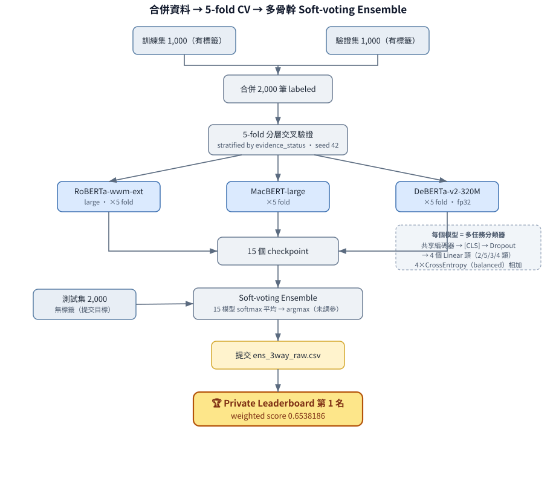
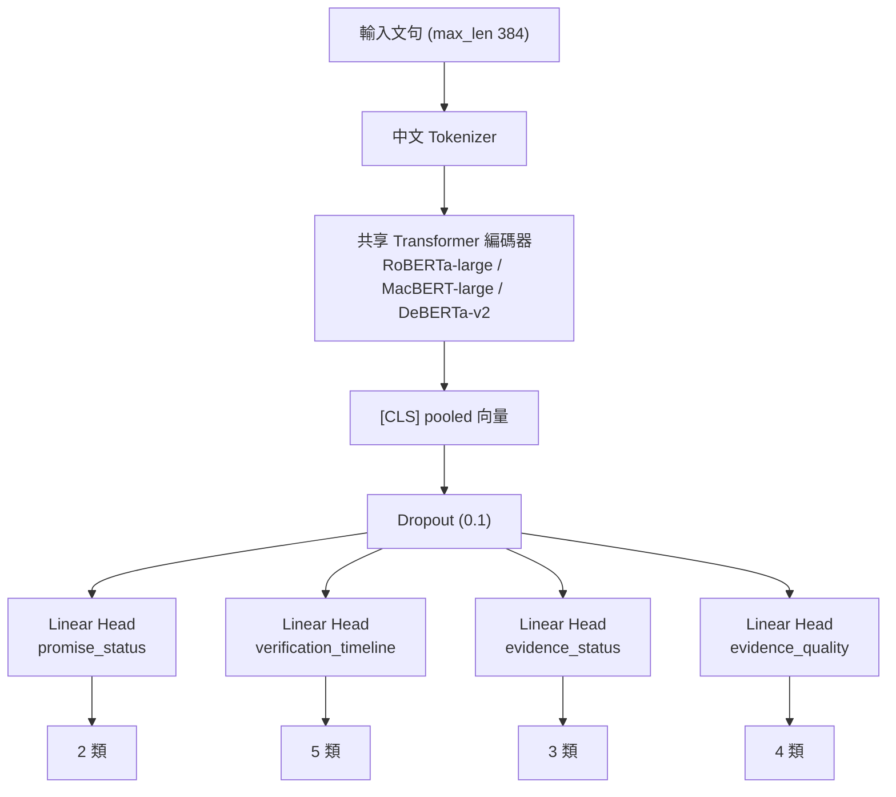
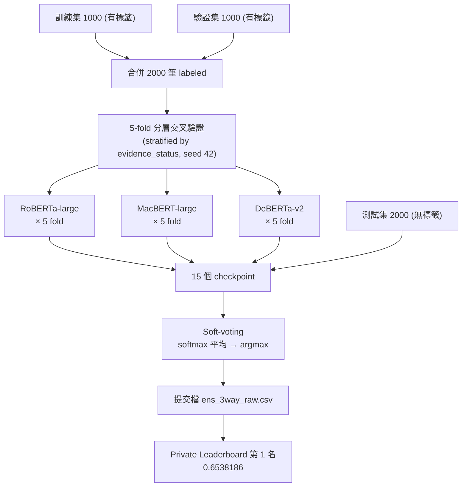

# ESG 永續承諾驗證競賽 2026 — 競賽報告

> **隊伍**：TEAM_10671　**最終成績**：Private Leaderboard 第 1 名（成績 0.6538186；Public 第 30 名）

---

## 1. 競賽任務與評分

對繁體中文 ESG 永續報告書文句，完成四個多分類子任務的自動標注：

| 子任務 | 類別 | 權重 |
|---|---|:---:|
| promise_status | Yes / No | 20% |
| verification_timeline | already / within_2_years / between_2_and_5_years / more_than_5_years / N/A | 15% |
| evidence_status | Yes / No / N/A | 30% |
| evidence_quality | Clear / Not Clear / Misleading / N/A | 35% |

各子任務以 **Macro-F1** 計分，總分為加權和：

```
總分 = evidence_quality × 0.35 + evidence_status × 0.30
     + promise_status × 0.20 + verification_timeline × 0.15
```

資料集：訓練集 1,000 筆、驗證集 1,000 筆（皆含標籤）、測試集 2,000 筆（無標籤，為提交目標）。

---

## 2. 整體方法概述

本解法是一個**多任務 Transformer 分類器**，並透過**多骨幹模型的交叉驗證 ensemble** 提升穩健度。核心設計理念有三：

1. **以共享編碼器 + 四個獨立分類頭**同時學習四個相關子任務，讓任務間共享語意表徵。
2. **合併官方驗證集進訓練、改用 5-fold 交叉驗證評估**，解決資料量不足與單一切分評估不穩的問題。
3. **三種中文預訓練骨幹（RoBERTa / MacBERT / DeBERTa）的 soft-voting ensemble**，以模型多樣性換取泛化能力。



> 上圖為端到端流程；下方 §3 提供模型內部結構與各步驟細節。（若提交格式為 PDF/Word，可直接嵌入 `reports/architecture.svg`。）

---

## 3. 模型架構與程式邏輯

### 3.1 多任務分類器（`scripts/train_baseline.py`）



> 共享編碼器 + 四個獨立分類頭；四個任務的 `CrossEntropyLoss`（均套用 balanced class weight）相加為總損失。

- **共享編碼器**：四個子任務共用同一個 Transformer，使「是否承諾／證據／時間軸／證據品質」之間的語意關聯能被聯合學習。
- **獨立分類頭**：每個子任務一個全連接層，輸出該任務的類別分布。
- **損失函數**：四個子任務的 `CrossEntropyLoss` 相加；每個任務都套用 **balanced class weight**（依各類別在訓練折中的出現頻率倒數加權），以對抗嚴重的類別不平衡（如 promise=No 僅約 18%、evidence_quality=Misleading 極稀少）。

### 3.2 訓練設定

| 項目 | RoBERTa / MacBERT | DeBERTa-v2 |
|---|---|---|
| 預訓練模型 | hfl/chinese-roberta-wwm-ext-large、hfl/chinese-macbert-large | IDEA-CCNL/Erlangshen-DeBERTa-v2-320M-Chinese |
| max_len | 384 | 384 |
| batch_size | 16 | 8 |
| 學習率 | 4e-5 | 2e-5 |
| epochs | 15（取驗證最佳 epoch） | 15 |
| 混合精度 fp16 | 開啟 | 關閉（見 §6 相容性問題） |
| optimizer | AdamW，weight_decay=0.01，warmup_ratio=0.1，grad_clip=1.0 | 同左 |
| class weight | balanced | balanced |
| 亂數種子 | 42 | 42 |

### 3.3 資料策略：合併驗證集 + 5-fold 交叉驗證

- **合併驗證集（`--merge-val`）**：官方驗證集 1,000 筆同樣帶標籤，併入訓練後得到 **2,000 筆**標註資料，直接倍增資料量，對稀少類別特別有幫助。
- **5-fold 交叉驗證（`--cv-folds 5`）**：以 `evidence_status` 做分層（stratified）切分（種子 42）。改用 CV 的動機是早期單一 hold-out 切分在不同種子下分數落差極大（0.558–0.643），無法可靠判斷改動是否真有效；CV 折平均±標準差才是可信的決策指標。
- 每個骨幹模型產生 5 個 fold checkpoint，最佳 epoch 落在第 6–12 epoch 之間。

### 3.4 推論與 Ensemble（`scripts/predict_test.py`）

- **Soft-voting**：對 3 骨幹 × 5 fold 共 **15 個 checkpoint**，分別輸出每個子任務的 softmax 機率，**取平均後 argmax** 作為最終預測。
- 平均在機率空間進行，使不同骨幹的信心度得以融合。
- 最終提交檔 `ens_3way_raw.csv` 即為此 15-checkpoint 的純 ensemble 結果（未做任何後處理閾值調整，理由見 §5）。

### 3.5 端到端流程



### 3.6 硬體環境與訓練時長

**硬體與軟體環境**

| 項目 | 規格 |
|---|---|
| GPU | NVIDIA TITAN RTX（24 GB VRAM） |
| CPU | 16 cores |
| 記憶體 | 62 GB |
| 作業系統 | Linux |
| 主要框架 | PyTorch 2.12.0（CUDA 12.6）、HuggingFace Transformers、scikit-learn |

**訓練時長**（5-fold 交叉驗證，每折產生 1 個 checkpoint）

| 骨幹模型 | 設定 | 每折約 | 5-fold 合計約 |
|---|---|:---:|:---:|
| RoBERTa-wwm-ext-large | bs16, fp16 | 21 min | **106 min** |
| MacBERT-large | bs16, fp16 | 21 min | **105 min** |
| DeBERTa-v2-320M | bs8, fp32 | 87 min | **434 min** |

- **訓練總計 ≈ 10.75 小時**（15 個 checkpoint）。
- **推論（ensemble）**：15 個模型對測試集 2,000 筆 soft-voting，約 10–15 分鐘。
- 備註：DeBERTa-v2 因與 fp16 不相容須改用 fp32 並將 batch 減半（見 §6），單模訓練時間約為其餘骨幹的 4 倍。

---

## 4. 各骨幹模型的交叉驗證結果

| 骨幹模型 | 5-fold CV 加權分數（OOF） | promise | timeline | ev_status | ev_quality |
|---|:---:|:---:|:---:|:---:|:---:|
| chinese-roberta-wwm-ext-large | **0.6224 ± 0.0165** | 0.809 | 0.599 | 0.697 | 0.462 |
| chinese-macbert-large | 0.6095 ± 0.0149 | 0.800 | 0.592 | 0.683 | 0.445 |
| Erlangshen-DeBERTa-v2-320M | 0.5948 ± 0.0182 | 0.785 | 0.532 | 0.680 | 0.440 |

RoBERTa-large 單模最強；MacBERT 與 DeBERTa 單模較弱，但作為 ensemble 成員可貢獻架構多樣性。

---

## 5. 關鍵決策：為何最終採用「未調參」的 ensemble

我們曾實作 **per-class 決策閾值調整（threshold tuning）**：在交叉驗證的 out-of-fold 預測上，以座標上升法搜尋每個類別的機率偏置以最大化 Macro-F1。此法在本地 OOF 上看似帶來 +0.01～0.015 的提升。

然而提交測試集後發現，**經調參的版本反而表現較差**：

| 提交版本 | 本地 OOF | Public LB | OOF→LB 落差 |
|---|:---:|:---:|:---:|
| RoBERTa ensemble（未調參） | 0.6239 | 0.6168 | −0.007 |
| roberta+macbert（**已調參**） | 0.6366 | 0.6117 | −0.025 |
| 3-way（**已調參**） | 0.6414 | 0.6172 | −0.024 |
| **3-way（未調參，最終提交）** | 0.6323 | 0.6176 | −0.015 |

**結論**：閾值是在「用來評估它的同一份 OOF」上最佳化的，屬於 in-sample 過擬合，灌水的分數無法轉移到測試集。最明顯的例證是 `evidence_quality` 的 Misleading 類別在全部 2,000 筆中僅 2 筆，調參卻給了它很大的正偏置，純粹在啃噪音。**因此最終提交採用未做閾值調整的純 ensemble（raw argmax），事後證明此決策正確——該版本在 Private Leaderboard 取得第 1 名。**

> 補充：`evidence_quality`（權重最高 35%）為本任務瓶頸，其 Macro-F1 約僅 0.44，主因是 Misleading 類別樣本數極少（4 類 Macro-F1 因此被天然壓在約 0.75 上限），標準監督式學習難以突破。

---

## 6. 工程實作與踩坑紀錄

- **DeBERTa-v2 與 AMP fp16 不相容**：訓練時出現 `Attempting to unscale FP16 gradients`，改為 fp32 訓練解決。
- **Erlangshen DeBERTa checkpoint 權重以 fp16 儲存**：載入後編碼器輸出為 Half，與 fp32 分類頭衝突（`mat1 and mat2 must have the same dtype`）；於模型建立時對編碼器呼叫 `.float()` 強制轉 fp32 解決（對 RoBERTa/MacBERT 為無作用）。

### 程式檔案

| 檔案 | 功能 |
|---|---|
| `scripts/train_baseline.py` | 多任務訓練；支援 `--merge-val`、`--cv-folds`、`--full-train` |
| `scripts/predict_test.py` | 載入多 checkpoint，soft-voting 推論，輸出提交 CSV |
| `scripts/tune_thresholds.py` | OOF 閾值調整（最終未採用其結果） |
| `scripts/run_lastday.sh`、`run_deberta_3way.sh`、`make_final_submission.sh` | 訓練／ensemble／提交流程腳本 |

---

## 7. 外部資源與生成式 AI 使用聲明

本隊誠實聲明所使用之外部資源如下：

### 7.1 預訓練模型（第三方開源，HuggingFace）

| 模型 | 來源／作者 | 用途 |
|---|---|---|
| `hfl/chinese-roberta-wwm-ext-large` | HFL（哈工大訊飛聯合實驗室） | 微調為分類骨幹 |
| `hfl/chinese-macbert-large` | HFL | 微調為分類骨幹 |
| `IDEA-CCNL/Erlangshen-DeBERTa-v2-320M-Chinese` | IDEA-CCNL（封神榜） | 微調為分類骨幹 |

以上模型皆為公開可取得之預訓練權重，本隊僅在競賽提供之資料上進行**監督式微調**，未使用任何競賽以外的標註資料。

### 7.2 開源函式庫

PyTorch、HuggingFace Transformers、scikit-learn、TensorBoard。

### 7.3 生成式 AI 輔助

- **工具與版本**：Claude Code（Anthropic Claude，使用模型 `claude-sonnet-4-6` 與 `claude-opus-4-8`）。
- **具體使用方法**：作為程式開發與分析的輔助工具，協助項目包括——撰寫／重構訓練與推論程式碼、設計交叉驗證與 ensemble 方法、除錯（如上述 DeBERTa fp16 相容性問題）、以及對實驗結果的分析與解讀（如辨識出閾值調整的過擬合現象）。
- **未使用之項目**：**未**使用任何生成式 AI 進行資料擴增、合成標籤（soft label）或特徵生成；所有模型訓練僅依賴競賽官方提供之標註資料。（本隊曾評估以 LLM 為 Misleading 類別產生 soft label，但最終並未實作採用。）
- **貢獻比例聲明**：競賽策略方向、所有實驗之執行、模型與提交決策、最終結果判讀，皆由隊伍主導與決定；生成式 AI 僅作為程式撰寫與分析之輔助。

---

## 8. 指導教授／業師資訊

`[若有指導教授／業師，請填寫以下欄位]`

- 姓名：`[請填寫]`
- 學校／公司名稱：`[請填寫]`
- 科系／職稱：`[請填寫]`
- 信箱：`[請填寫]`

---

## 9. 結論

本解法以「**合併資料 + 交叉驗證 + 多骨幹 soft-voting ensemble**」為主軸，並透過誠實的 OOF↔LB 校正分析，**辨識並避開了閾值調整的過擬合陷阱**，最終以未調參的 3-骨幹 ensemble 在 Private Leaderboard 取得**第 1 名**（0.6538186）。最大的方法論收穫是：在小型資料集上，**可信的離線驗證指標（raw argmax CV）比追求帳面分數的後處理更重要**。
