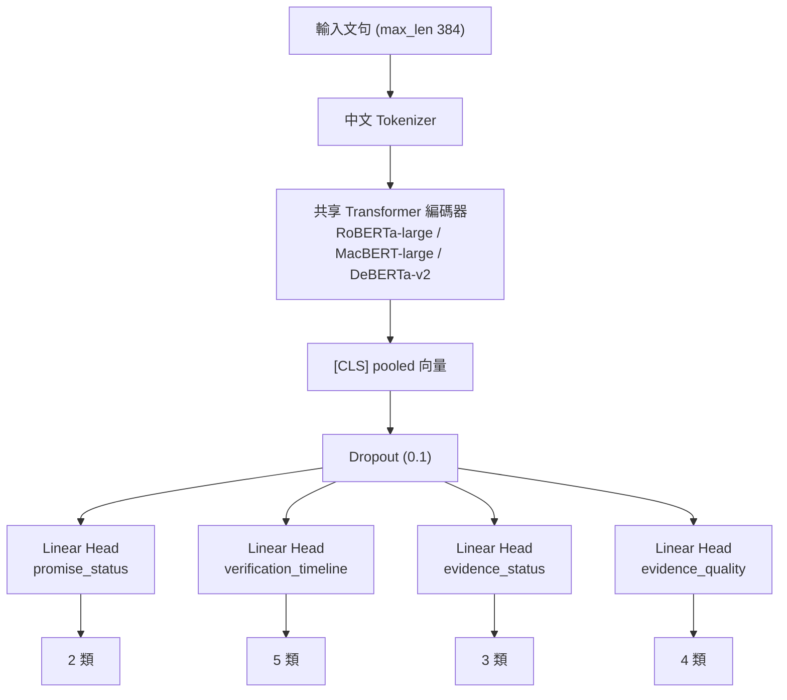
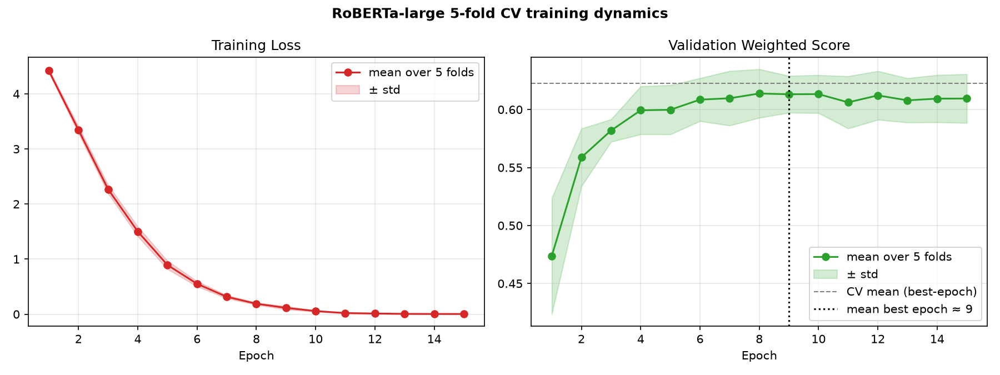
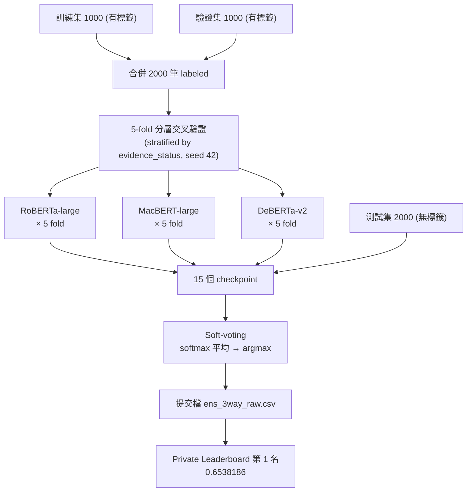
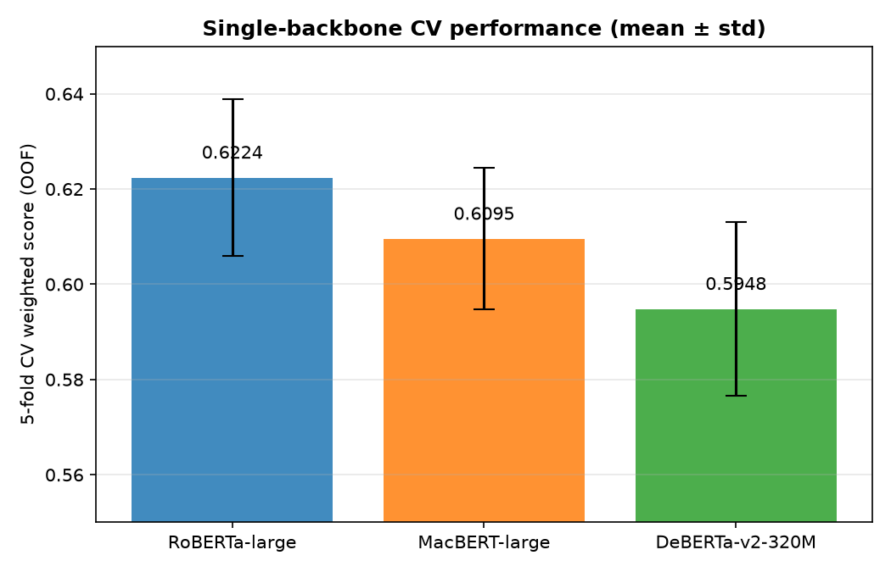
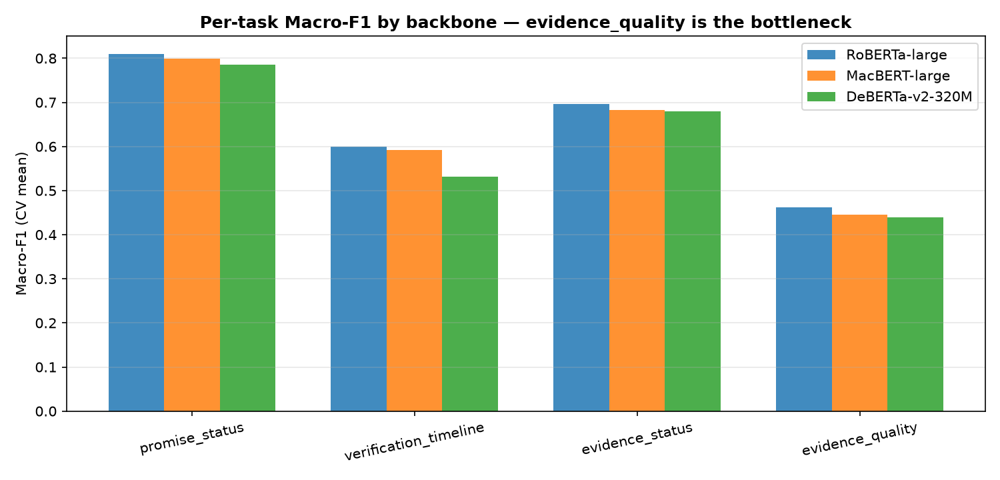
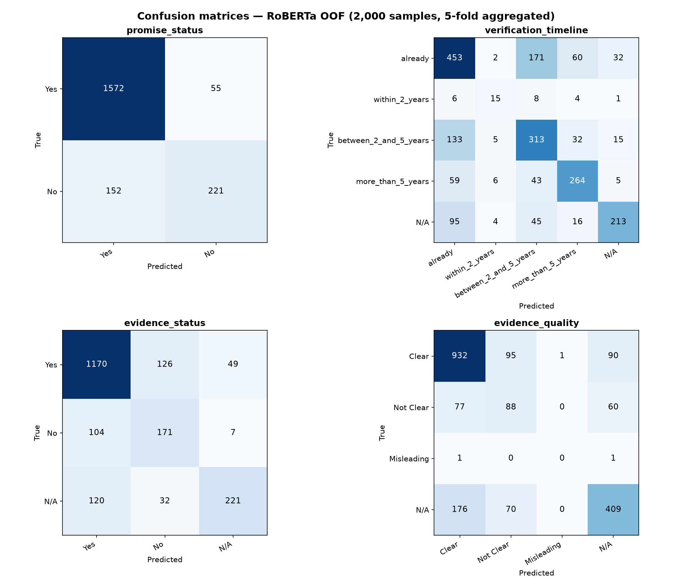
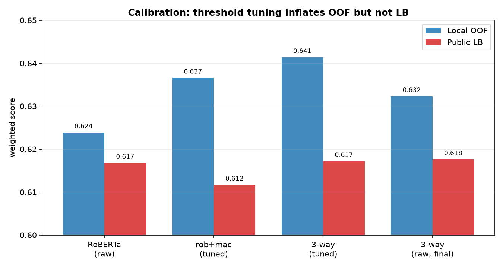
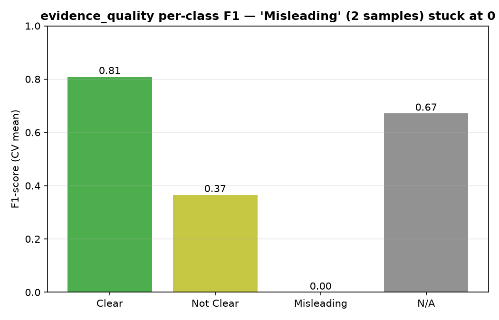

# ESG 永續承諾驗證競賽 2026 — 競賽報告

> **隊伍**：TEAM_10671　**最終成績**：Private Leaderboard 第 1 名（成績 0.6538186；Public 第 30 名）

### 對應主辦建議報告架構

| 主辦段落 | 對應本報告章節 |
|---|---|
| 壹、環境 | §1.1 執行環境 |
| 貳、演算方法與模型架構 | §2、§3.1–§3.2 |
| 參、創新性 | §5.5 創新性 |
| 肆、資料處理 | §3.3 |
| 伍、訓練方式 | §3.2、§3.4 |
| 陸、分析與結論 | §4、§5、§6、§9 |
| 柒、程式碼 | §7（含 GitHub 連結與 `README.md` 重現說明） |
| 捌、外部資源與參考文獻 | §8、§10 |

---

## 1. 競賽任務與評分

對繁體中文 ESG 永續報告書文句，完成四個多分類子任務的自動標注：

| 子任務 | 類別 | 權重 |
|---|---|:---:|
| promise_status | Yes / No | 20% |
| verification_timeline | already / within_2_years / between_2_and_5_years / more_than_5_years / N/A | 15% |
| evidence_status | Yes / No / N/A | 30% |
| evidence_quality | Clear / Not Clear / Misleading / N/A | 35% |

各子任務以 **Macro-F1** 計分，總分為加權和：

```
總分 = evidence_quality × 0.35 + evidence_status × 0.30
     + promise_status × 0.20 + verification_timeline × 0.15
```

資料集：訓練集 1,000 筆、驗證集 1,000 筆（皆含標籤）、測試集 2,000 筆（無標籤，為提交目標）。

### 1.1 執行環境

**作業系統與語言**：Linux；Python 3.12。

**硬體**：單張 NVIDIA TITAN RTX（24 GB VRAM）、16 核 CPU、62 GB RAM。

**主要套件（函式庫）**：

| 套件 | 版本 | 用途 |
|---|---|---|
| PyTorch | 2.12.0（CUDA 12.6） | 深度學習訓練框架 |
| HuggingFace Transformers | ≥ 4.30 | 載入與微調預訓練模型 |
| scikit-learn | ≥ 1.2 | 分層 K-fold 切分、Macro-F1 計算 |
| NumPy / pandas | ≥ 1.24 / ≥ 2.0 | 數值與資料處理 |
| TensorBoard | ≥ 2.14 | 訓練曲線記錄 |

**預訓練模型（皆為 HuggingFace 公開權重）**：

| 模型 | 來源 URL |
|---|---|
| chinese-roberta-wwm-ext-large | https://huggingface.co/hfl/chinese-roberta-wwm-ext-large |
| chinese-macbert-large | https://huggingface.co/hfl/chinese-macbert-large |
| Erlangshen-DeBERTa-v2-320M-Chinese | https://huggingface.co/IDEA-CCNL/Erlangshen-DeBERTa-v2-320M-Chinese |

**額外資料集**：無。本隊僅使用競賽官方提供之訓練／驗證／測試集，未引入任何外部標註資料。

---

## 2. 整體方法概述

本解法是一個**多任務 Transformer 分類器**，並透過**多骨幹模型的交叉驗證 ensemble** 提升穩健度。核心設計理念有三：

1. **以共享編碼器 + 四個獨立分類頭**同時學習四個相關子任務，讓任務間共享語意表徵。
2. **合併官方驗證集進訓練、改用 5-fold 交叉驗證評估**，解決資料量不足與單一切分評估不穩的問題。
3. **三種中文預訓練骨幹（RoBERTa / MacBERT / DeBERTa）的 soft-voting ensemble**，以模型多樣性換取泛化能力。


> 上圖為端到端流程；下方 §3 提供模型內部結構與各步驟細節。（若提交格式為 PDF/Word，可直接嵌入 `reports/architecture.svg`。）

---

## 3. 模型架構與程式邏輯

### 3.1 多任務分類器（`scripts/train_baseline.py`）



> 共享編碼器 + 四個獨立分類頭；四個任務的 `CrossEntropyLoss`（均套用 balanced class weight）相加為總損失。

- **共享編碼器**：四個子任務共用同一個 Transformer，使「是否承諾／證據／時間軸／證據品質」之間的語意關聯能被聯合學習。
- **獨立分類頭**：每個子任務一個全連接層，輸出該任務的類別分布。
- **損失函數**：四個子任務的 `CrossEntropyLoss` 相加；每個任務都套用 **balanced class weight**（依各類別在訓練折中的出現頻率倒數加權），以對抗嚴重的類別不平衡（如 promise=No 僅約 18%、evidence_quality=Misleading 極稀少）。

### 3.2 訓練設定

| 項目 | RoBERTa / MacBERT | DeBERTa-v2 |
|---|---|---|
| 預訓練模型 | hfl/chinese-roberta-wwm-ext-large、hfl/chinese-macbert-large | IDEA-CCNL/Erlangshen-DeBERTa-v2-320M-Chinese |
| max_len | 384 | 384 |
| batch_size | 16 | 8 |
| 學習率 | 4e-5 | 2e-5 |
| epochs | 15（取驗證最佳 epoch） | 15 |
| 混合精度 fp16 | 開啟 | 關閉（見 §6 相容性問題） |
| optimizer | AdamW，weight_decay=0.01，warmup_ratio=0.1，grad_clip=1.0 | 同左 |
| class weight | balanced | balanced |
| 亂數種子 | 42 | 42 |



> 圖 1：RoBERTa-large 5-fold 的訓練動態（mean ± std）。**左圖**訓練損失平滑且單調收斂至接近 0，代表模型確實在學習、無發散；**右圖**驗證加權分數上升後於第 6–9 epoch 達高原（黑色虛線為平均最佳 epoch）而非崩跌，顯示無嚴重過擬合。我們即取「驗證最佳 epoch」的 checkpoint，作為兼顧收斂與泛化的訓練過程佐證。

### 3.3 資料策略：合併驗證集 + 5-fold 交叉驗證

- **標籤正規化**：官方資料中部分欄位以空字串 `""` 表示「不適用」，程式在載入時統一正規化為 `N/A`（見 `train_baseline.py` 的 `normalize_sample`），並驗證每個欄位的值都落在合法類別集合內，避免標籤不一致。
- **未做刪減或人為更正**：保留全部 2,000 筆標註資料，未刪除或竄改任何標籤；對極稀少的 `Misleading`（僅 2 筆）採「保留 + class weight 加權」而非刪除。
- **文字長度分析決定 `max_len`**：訓練文句平均約 208 字、超過 256 字者不在少數，故將截斷長度設為 **384**（涵蓋絕大多數樣本，且優於 512 的訓練效率）。
- **合併驗證集（`--merge-val`）**：官方驗證集 1,000 筆同樣帶標籤，併入訓練後得到 **2,000 筆**標註資料，直接倍增資料量，對稀少類別特別有幫助。
- **類別不平衡處理**：各子任務皆有嚴重不平衡（如 promise=No 約 18%、Misleading 極稀少），以 **balanced class weight**（頻率倒數加權）於損失函數中補償，而非重採樣。
- **5-fold 交叉驗證（`--cv-folds 5`）**：以 `evidence_status` 做分層（stratified）切分（種子 42）。改用 CV 的動機是早期單一 hold-out 切分在不同種子下分數落差極大（0.558–0.643），無法可靠判斷改動是否真有效；CV 折平均±標準差才是可信的決策指標。
- 每個骨幹模型產生 5 個 fold checkpoint，最佳 epoch 落在第 6–12 epoch 之間。

### 3.4 推論與 Ensemble（`scripts/predict_test.py`）

- **Soft-voting**：對 3 骨幹 × 5 fold 共 **15 個 checkpoint**，分別輸出每個子任務的 softmax 機率，**取平均後 argmax** 作為最終預測。
- 平均在機率空間進行，使不同骨幹的信心度得以融合。
- 最終提交檔 `ens_3way_raw.csv` 即為此 15-checkpoint 的純 ensemble 結果（未做任何後處理閾值調整，理由見 §5）。

### 3.5 端到端流程



### 3.6 硬體環境與訓練時長

**硬體與軟體環境**

| 項目 | 規格 |
|---|---|
| GPU | NVIDIA TITAN RTX（24 GB VRAM） |
| CPU | 16 cores |
| 記憶體 | 62 GB |
| 作業系統 | Linux |
| 主要框架 | PyTorch 2.12.0（CUDA 12.6）、HuggingFace Transformers、scikit-learn |

**訓練時長**（5-fold 交叉驗證，每 fold 產生 1 個 checkpoint）

| 骨幹模型 | 設定 | 每 fold 約 | 5-fold 合計約 |
|---|---|:---:|:---:|
| RoBERTa-wwm-ext-large | bs16, fp16 | 21 min | **106 min** |
| MacBERT-large | bs16, fp16 | 21 min | **105 min** |
| DeBERTa-v2-320M | bs8, fp32 | 87 min | **434 min** |

- **訓練總計 ≈ 10.75 小時**（15 個 checkpoint）。
- **推論（ensemble）**：15 個模型對測試集 2,000 筆 soft-voting，約 10–15 分鐘。
- 備註：DeBERTa-v2 因與 fp16 不相容須改用 fp32 並將 batch 減半（見 §6），單模訓練時間約為其餘骨幹的 4 倍。

---

## 4. 各骨幹模型的交叉驗證結果

| 骨幹模型 | 5-fold CV 加權分數（OOF） | promise | timeline | ev_status | ev_quality |
|---|:---:|:---:|:---:|:---:|:---:|
| chinese-roberta-wwm-ext-large | **0.6224 ± 0.0165** | 0.809 | 0.599 | 0.697 | 0.462 |
| chinese-macbert-large | 0.6095 ± 0.0149 | 0.800 | 0.592 | 0.683 | 0.445 |
| Erlangshen-DeBERTa-v2-320M | 0.5948 ± 0.0182 | 0.785 | 0.532 | 0.680 | 0.440 |

RoBERTa-large 單模最強；MacBERT 與 DeBERTa 單模較弱，但作為 ensemble 成員可貢獻架構多樣性。



> 圖 2：三種骨幹的 5-fold CV 加權分數（mean ± std）。



> 圖 3：逐任務 Macro-F1。三款骨幹一致顯示 `evidence_quality` 為共同瓶頸。

### 4.1 混淆矩陣與錯誤分析



> 圖 6：RoBERTa 在 5-fold out-of-fold 上彙整的四任務混淆矩陣（共 2,000 筆）。

由混淆矩陣可觀察各任務的錯誤型態：

- **promise_status**：整體最佳，主要誤差為少數類 `No` 被誤判為 `Yes`（recall 偏低），符合 No 僅約 18% 的不平衡特性。
- **verification_timeline**：混淆集中於 `already`／`between_2_and_5_years`／`more_than_5_years` 三者之間——這些時間界線在語意上本就模糊；`within_2_years` 因樣本極少而幾乎無法辨識。
- **evidence_status**：三類大致可分，少量 `Yes` 與 `No`／`N/A` 互混。
- **evidence_quality**：`Clear` 辨識良好；`Not Clear` 常被誤判為 `Clear` 或 `N/A`（清晰度判斷偏主觀）；**`Misleading` 兩筆全數預測錯誤**，直接印證 §5 所述的資料稀少瓶頸。

---

## 5. 關鍵決策：為何最終採用「未調參」的 ensemble

我們曾實作 **per-class 決策閾值調整（threshold tuning）**：在交叉驗證的 out-of-fold 預測上，以座標上升法搜尋每個類別的機率偏置以最大化 Macro-F1。此法在本地 OOF 上看似帶來 +0.01～0.015 的提升。

然而提交測試集後發現，**經調參的版本反而表現較差**：

| 提交版本 | 本地 OOF | Public LB | OOF→LB 落差 |
|---|:---:|:---:|:---:|
| RoBERTa ensemble（未調參） | 0.6239 | 0.6168 | −0.007 |
| roberta+macbert（**已調參**） | 0.6366 | 0.6117 | −0.025 |
| 3-way（**已調參**） | 0.6414 | 0.6172 | −0.024 |
| **3-way（未調參，最終提交）** | 0.6323 | 0.6176 | −0.015 |

**結論**：閾值是在「用來評估它的同一份 OOF」上最佳化的，屬於 in-sample 過擬合，灌水的分數無法轉移到測試集。最明顯的例證是 `evidence_quality` 的 Misleading 類別在全部 2,000 筆中僅 2 筆，調參卻給了它很大的正偏置，純粹在啃噪音。**因此最終提交採用未做閾值調整的純 ensemble（raw argmax），事後證明此決策正確——該版本在 Private Leaderboard 取得第 1 名。**



> 圖 4：本地 OOF 與 Public LB 對照。已調參版本（中間兩組）在 OOF 上最高，實際 LB 卻最低，清楚顯示閾值調整的過擬合；未調參版本（左、右）落差最小。

> 補充：`evidence_quality`（權重最高 35%）為本任務瓶頸，其 Macro-F1 約僅 0.44，主因是 Misleading 類別樣本數極少（4 類 Macro-F1 因此被天然壓在約 0.75 上限），標準監督式學習難以突破。



> 圖 5：`evidence_quality` 逐類別 F1（RoBERTa 5-fold 平均）。`Misleading` 因全資料僅 2 筆而恆為 0，是 4 類 Macro-F1 被壓低的主因。

### 5.5 創新性

本解法的創新並非單一新模型，而是在**小型、極度不平衡資料集**上的一套穩健決策方法論：

1. **以校正分析（calibration）驅動的反過擬合決策**：我們建立「本地 OOF 分數 ↔ 實際 Leaderboard 分數」的對照（§5 表），量化發現後處理閾值調整雖能灌水本地分數 +0.015，卻在測試集上反向衰退。據此**主動棄用**多數隊伍慣用的閾值後處理，改採未調參的純 ensemble。這個「不貪心」的反直覺決策，正是奪冠關鍵。

2. **小資料的穩健評估設計**：合併官方驗證集使標註資料倍增（1,000 → 2,000），並以分層 5-fold 交叉驗證取代單一 hold-out，將原本受亂數種子影響高達 0.558–0.643 的評估雜訊，收斂為可信的折平均 ± 標準差，使後續每一項決策都有可靠依據。

3. **異質多骨幹 soft-voting**：刻意選用架構互異的三種中文預訓練模型（RoBERTa / MacBERT / DeBERTa），即使較弱的骨幹（如 DeBERTa 單模 0.595）也能因「犯錯方式不同」而在投票中貢獻正向多樣性。

4. **對官方 baseline 的具體擴充**：官方範例僅為「單一 hold-out、單模型」訓練腳本。本隊在其上新增 `--merge-val`（合併驗證集）、`--cv-folds`（交叉驗證）、`--full-train`（全量訓練）三項能力，並自行開發 `predict_test.py`（多 checkpoint soft-voting 推論）與 `tune_thresholds.py`（OOF 閾值分析工具），形成完整的訓練—評估—推論管線。

---

## 6. 工程實作與踩坑紀錄

- **DeBERTa-v2 與 AMP fp16 不相容**：訓練時出現 `Attempting to unscale FP16 gradients`，改為 fp32 訓練解決。
- **Erlangshen DeBERTa checkpoint 權重以 fp16 儲存**：載入後編碼器輸出為 Half，與 fp32 分類頭衝突（`mat1 and mat2 must have the same dtype`）；於模型建立時對編碼器呼叫 `.float()` 強制轉 fp32 解決（對 RoBERTa/MacBERT 為無作用）。

### 程式檔案

GitHub repository: https://github.com/whyhugo/VeriPromiseESG

| 檔案 | 功能 |
|---|---|
| `scripts/train_baseline.py` | 多任務訓練；支援 `--merge-val`、`--cv-folds`、`--full-train` |
| `scripts/predict_test.py` | 載入多 checkpoint，soft-voting 推論，輸出提交 CSV |
| `scripts/tune_thresholds.py` | OOF 閾值調整（最終未採用其結果） |
| `scripts/run_lastday.sh`、`run_deberta_3way.sh`、`make_final_submission.sh` | 訓練／ensemble／提交流程腳本 |

---

## 7. 外部資源與生成式 AI 使用聲明

本隊誠實聲明所使用之外部資源如下：

### 7.1 預訓練模型（第三方開源，HuggingFace）

| 模型 | 來源／作者 | 用途 |
|---|---|---|
| `hfl/chinese-roberta-wwm-ext-large` | HFL（哈工大訊飛聯合實驗室） | 微調為分類骨幹 |
| `hfl/chinese-macbert-large` | HFL | 微調為分類骨幹 |
| `IDEA-CCNL/Erlangshen-DeBERTa-v2-320M-Chinese` | IDEA-CCNL（封神榜） | 微調為分類骨幹 |

以上模型皆為公開可取得之預訓練權重，本隊僅在競賽提供之資料上進行**監督式微調**，未使用任何競賽以外的標註資料。

### 7.2 開源函式庫

PyTorch、HuggingFace Transformers、scikit-learn、TensorBoard。

### 7.3 生成式 AI 輔助

- **工具與版本**：Claude Code（Anthropic Claude，使用模型 `claude-sonnet-4-6` 與 `claude-opus-4-8`）。
- **具體使用方法**：作為程式開發與分析的輔助工具，協助項目包括——撰寫／重構訓練與推論程式碼、設計交叉驗證與 ensemble 方法、除錯（如上述 DeBERTa fp16 相容性問題）、以及對實驗結果的分析與解讀（如辨識出閾值調整的過擬合現象）。
- **未使用之項目**：**未**使用任何生成式 AI 進行資料擴增、合成標籤（soft label）或特徵生成；所有模型訓練僅依賴競賽官方提供之標註資料。（本隊曾評估以 LLM 為 Misleading 類別產生 soft label，但最終並未實作採用。）
- **貢獻比例聲明**：競賽策略方向、所有實驗之執行、模型與提交決策、最終結果判讀，皆由隊伍主導與決定；生成式 AI 僅作為程式撰寫與分析之輔助。

---

## 8. 結論

本解法以「**合併資料 + 交叉驗證 + 多骨幹 soft-voting ensemble**」為主軸，並透過誠實的 OOF↔LB 校正分析，**辨識並避開了閾值調整的過擬合陷阱**，最終以未調參的 3-骨幹 ensemble 在 Private Leaderboard 取得**第 1 名**（0.6538186）。最大的方法論收穫是：在小型資料集上，**可信的離線驗證指標（raw argmax CV）比追求帳面分數的後處理更重要**。

---

## 9. 未來工作（Future Works）

本次解法仍有明確的改進空間，依預期效益排序如下。

### 9.1 攻克 `evidence_quality` 瓶頸（最高優先）

`evidence_quality` 權重最高（35%）卻分數最低（~0.44），主因是 `Misleading` 類別在全部 2,000 筆中僅 2 筆，標準監督式學習幾乎無法學會，使 4 類 Macro-F1 被天然壓在約 0.75 上限。可嘗試：

- **以 LLM 進行資料擴增 / soft labeling**：用大型語言模型（如 GPT-4o、Claude、Qwen）依據官方標註定義，為訓練文句生成 `Misleading` 的合成樣本或軟標籤，補足稀少類別的監督訊號。
- **標籤體系重構**：將 `Misleading` 暫時併入 3 類分類（Clear / Not Clear / N/A）穩定主分類，再以獨立的二元偵測器或規則／檢索方式專門辨識 `Misleading`。
- **針對性損失**：以 focal loss 或對比學習（contrastive learning）強化困難與少數類別的判別邊界。

### 9.2 多模態（MLLM）解法

競賽資料附有報告書的 `pdf_url` 與 `page_number`，而「證據品質」往往取決於該頁是否有**數據、表格、圖表**等視覺與版面資訊——這些在純文字管線中會遺失。未來可：

- **引入視覺語言模型（Vision-Language / MLLM）**（如 Qwen2-VL、GPT-4o、Claude 視覺）：同時輸入報告頁面影像與文字，讓模型「看見」表格與數據佐證，預期對 `evidence_status` 與 `evidence_quality` 特別有幫助。
- **版面感知文件理解模型**（如 LayoutLM 系列）：融合文字、座標與版面結構，捕捉純文字無法表達的證據強度線索。

### 9.3 以 LLM 直接作答的解法

- **指令微調 / few-shot LLM**：將官方四任務定義寫成提示詞，讓 LLM 以結構化輸出（JSON）直接作答；對 `evidence_quality` 這類偏主觀的任務，可採 **LLM-as-judge** 思路。
- **與本方案 ensemble**：把 LLM 的判斷作為第 4 個「投票成員」併入現有 soft-voting，增加異質多樣性。

### 9.4 建模與後處理的進階方向

- **任務間邏輯約束解碼**：官方定義存在強邏輯關係（如 `promise_status=No` 時其餘三項應為 `N/A`、`evidence_status` 為 No/N/A 時 `evidence_quality` 應為 `N/A`）。在推論時強制這些一致性約束，可零成本修正互相矛盾的預測。
- **更強的中文骨幹**：嘗試更新、更大的中文預訓練模型（如 Qwen 系列 encoder），或領域繼續預訓練（domain-adaptive pretraining）於 ESG 永續報告語料。
- **半監督 / 偽標籤**：對測試集做 pseudo-labeling 後回饋訓練（須嚴格防止標籤洩漏）。
- **可被正確驗證的後處理**：若仍要做閾值或權重調整，務必採**巢狀交叉驗證（nested CV）或獨立 holdout** 驗證其可轉移性，避免重蹈本次 in-sample 過擬合的覆轍。

---

## 10. 參考文獻

**預訓練模型**

- Cui, Y., Che, W., Liu, T., Qin, B., & Yang, Z. (2021). Pre-training with whole word masking for Chinese BERT. *IEEE/ACM Transactions on Audio, Speech, and Language Processing, 29*, 3504–3514. https://doi.org/10.1109/TASLP.2021.3124365
- Cui, Y., Che, W., Liu, T., Qin, B., Wang, S., & Hu, G. (2020). Revisiting pre-trained models for Chinese natural language processing. In *Findings of the Association for Computational Linguistics: EMNLP 2020* (pp. 657–668). https://doi.org/10.18653/v1/2020.findings-emnlp.58
- He, P., Liu, X., Gao, J., & Chen, W. (2021). DeBERTa: Decoding-enhanced BERT with disentangled attention. In *International Conference on Learning Representations (ICLR 2021)*. https://arxiv.org/abs/2006.03654
- Wang, J., Zhang, Y., Zhang, L., Yang, P., Gao, X., Wu, Z., … Zhang, J. (2022). *Fengshenbang 1.0: Being the foundation of Chinese cognitive intelligence* [Preprint]. arXiv. https://arxiv.org/abs/2209.02970

**開源框架與函式庫**

- Paszke, A., Gross, S., Massa, F., Lerer, A., Bradbury, J., Chanan, G., … Chintala, S. (2019). PyTorch: An imperative style, high-performance deep learning library. In *Advances in Neural Information Processing Systems 32* (pp. 8024–8035).
- Wolf, T., Debut, L., Sanh, V., Chaumond, J., Delangue, C., Moi, A., … Rush, A. M. (2020). Transformers: State-of-the-art natural language processing. In *Proceedings of the 2020 Conference on Empirical Methods in Natural Language Processing: System Demonstrations* (pp. 38–45). https://doi.org/10.18653/v1/2020.emnlp-demos.6
- Pedregosa, F., Varoquaux, G., Gramfort, A., Michel, V., Thirion, B., Grisel, O., … Duchesnay, É. (2011). Scikit-learn: Machine learning in Python. *Journal of Machine Learning Research, 12*, 2825–2830.

**生成式 AI 工具**

- Anthropic. (2026). *Claude Code（Claude，模型 claude-sonnet-4-6 與 claude-opus-4-8）* [大型語言模型輔助工具]. https://www.anthropic.com
